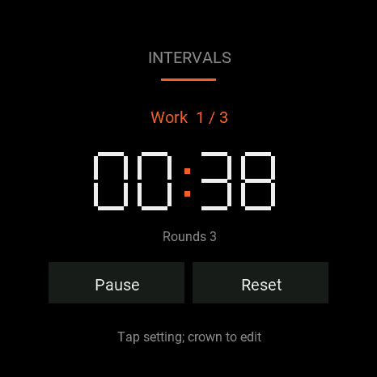
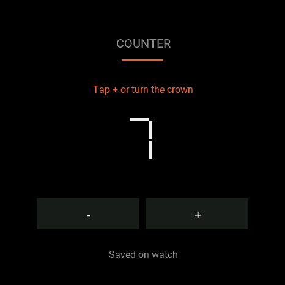
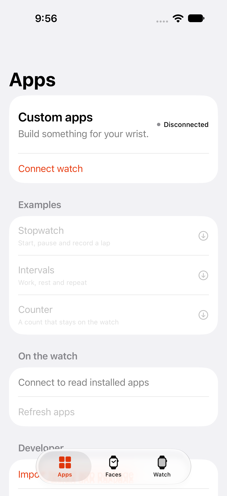
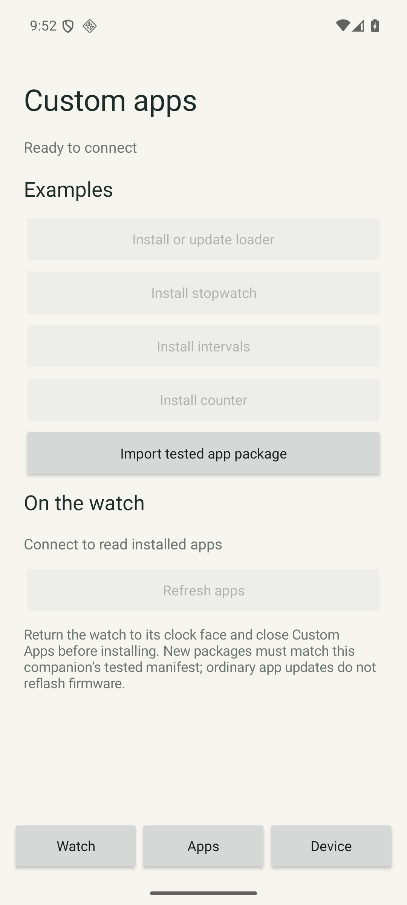

# CMF Watch Workbench

A base for building custom apps and watch faces for the **CMF Watch Pro 2**.
It includes a Rust SDK, a stock-based app loader, a simulator, and small iOS
and Android companions you can extend for your own project.

[Try the controls](https://connorsawaya.github.io/cmf-watch-workbench/) ·
[Install & build](docs/getting-started.md) · [Write an app](docs/apps.md) ·
[Build the companions](docs/companions.md) · [Watch faces](docs/watch-faces.md)

<p align="center">
  
  
  
</p>

*Actual app output captured from the host simulator.*

## Build an app

The loader adds **Custom Apps** to the stock watch's app list. Eight independent
slots let you add or update an app without repeating the initial firmware flash.
Apps draw on the 466 × 466 display and receive touch, crown, button and lifecycle
events. The SDK provides messages, atomic storage, clock, battery, display wake,
haptics and supported sensor services.

| Example | Behavior |
| --- | --- |
| Stopwatch | Start, pause, lap and reset using the watch's monotonic clock. |
| Intervals | Choose work, rest and rounds, with timed transitions and haptics. |
| Counter | Tap or turn the crown; restore the saved count next time. |

Copy an example, add its crate to the workspace, test it, then build a `.wp2app`
package. The [app guide](docs/apps.md) covers budgets, storage and verification.

## Start with a small companion

Both phone apps provide Bluetooth pairing, device and battery status, reviewed
package installation, and a watch-face editor/importer. Their protocol libraries
are separate from the screens, so you can add your own app-specific controls
and messages. They are a starting point for developers, with readings supplied
by the watch and installation progress confirmed by the device.

<p align="center">
  
  
</p>

Create a face with a photo background and clock colour, or import/export supported
WFDL files. Face upload uses the stock face channel and needs a free face slot.
It does not require a new firmware flash. [Watch-face guide](docs/watch-faces.md).

[Download the signed Android APK](https://github.com/ConnorSawaya/cmf-watch-workbench/releases/latest).
iOS builds with Xcode and your own signing team.

## Supported hardware

The ROM port targets **Watch Pro 2, JX402 / D398, firmware 1.0.0.73**. Other
models and firmware versions are unsupported. The initial stock patch can leave
a watch unusable; physical recovery is not universally verified. Native apps
are not a security sandbox. Review code and use the emulator before installation.
See [compatibility and verification](docs/compatibility.md).

## Source layout

```text
firmware/wp2-apps/   Rust SDK, stock stub, app loader, simulator and BLE CLI
ios/Workbench/      SwiftUI base companion
ios/CompanionCore/  Independently testable Swift protocol library
android/            Android base companion and JVM protocol library
tools/              App packaging, staging and runtime verification
docs/               Installation, development and captured app output
```

Built on [cmf-tech-community/cmf-watch-sdk](https://github.com/cmf-tech-community/cmf-watch-sdk).
Upstream copyrights and the MIT license are retained. The external emulator and
firmware tools are installed separately; vendor firmware, ROMs and OTA images
must be supplied locally.

Code: MIT. Roboto: Apache 2.0. See [NOTICE](NOTICE.md).
