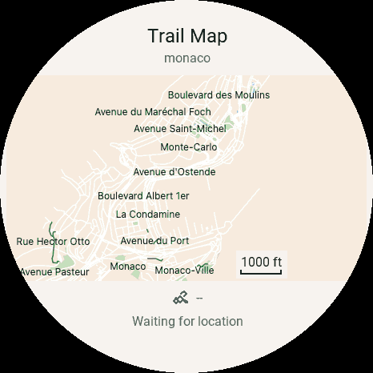
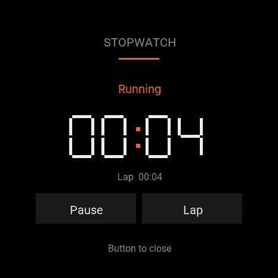
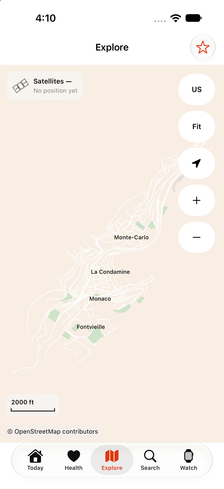
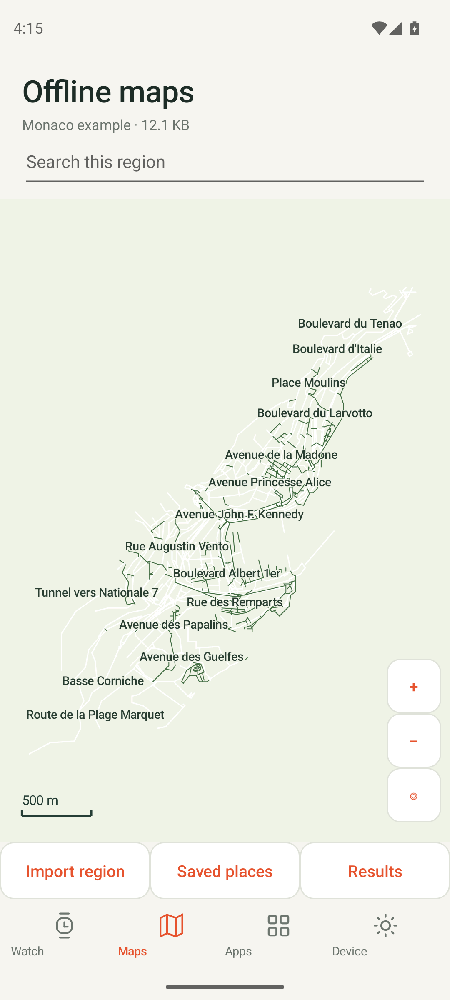

# CMF Watch Workbench

Custom apps for the **CMF Watch Pro 2**: a Rust SDK, a stock-based app loader,
offline maps, and companions for iOS and Android.

[Interactive controls](https://connorsawaya.github.io/cmf-watch-workbench/) ·
[Install & build](docs/getting-started.md) · [Write an app](docs/apps.md) ·
[Map regions](docs/maps.md) · [Compatibility](docs/compatibility.md)

<p align="center">
  
  
  
</p>

*Captured app output from the watch simulator. The map example uses a pinned,
historical OpenStreetMap extract of Monaco.*

## A platform for apps

The loader adds **Custom Apps** to the watch's stock app list. Apps install into
eight independent slots; adding or updating an app does not reflash the stock
firmware. They draw on the 466 × 466 screen and receive real touch, crown,
button, pause and resume events.

| App | What it does |
| --- | --- |
| **Trail Map** | Offline vectors, crown zoom, swipe panning, a scale bar, built-in GNSS, last-known position, 32 saved places and resumable map downloads. |
| **Stopwatch** | Start, pause, lap and reset, using the watch's monotonic clock. |
| **Intervals** | Set work, rest and rounds with the crown; timed transitions use bounded haptic pulses. |
| **Counter** | Tap or turn the crown; the count is saved on the watch and restored next time. |

These are native Rust apps using the same public SDK. Start a new app from an
example, add its crate to the workspace, test it, and package it as `.wp2app`.
The SDK exposes drawing, input, messages, atomic storage, time, battery,
screen wake control, haptics and the supported sensor services.

## One workbench, two companions

<p align="center">
  
  
</p>

Both companions have actual Bluetooth protocol implementations: pairing,
battery and health reads, alarms, favorite contacts, units, monitoring and
supported daily settings. Their app managers check package checksums, firmware,
the latest battery reading and whether Custom Apps is closed before installing.
Map transfers report received bytes and resume at the watch-confirmed offset.

Unknown readings stay empty until the watch supplies them. See the
[feature and verification matrix](docs/compatibility.md) for differences between
platforms and the stock phone app.

[Download the signed Android APK](https://github.com/ConnorSawaya/cmf-watch-workbench/releases/latest). Android also builds locally to an installable APK. iOS builds with Xcode and your own signing
team. [Build the companions](docs/companions.md).

## Choose your own offline region

Import an OpenStreetMap extract, optionally clip it with a GeoJSON polygon, and
build a phone map and a smaller watch map. Coverage is selected at build/import
time. No account or map server is needed to draw, search or pan an imported map.

```sh
uv sync
uv run python tools/import_map.py --source area.osm.pbf --output build/area.sqlite
uv run python tools/build_watch_map.py --source build/area.sqlite \
  --output build/area.wp2map --profile outdoors --coverage "My offline region"
uv run python tools/check_watch_map.py build/area.wp2map
```

The watch pack uses simplified vector geometry and a spatial index. It has a
9.2 MB transfer limit and checks actual free watch storage before staging a new
file. The old active map stays until the replacement is complete and verified.
The default outdoors profile includes named streets, trails, parks and water.
Buildings and most unnamed urban sidewalks are omitted; see [map profiles](docs/maps.md).

Search shows at most 300 results. Saved-point GPX/GeoJSON import and GPX export
allow bookmark exchange with Organic Maps. Its MWM files are a different format;
this project does not stream Organic Maps tiles or decode MWM files.

## Start here

1. **Check the device.** The current ROM port is for Watch Pro 2 **JX402 / D398,
   firmware 1.0.0.73**. Other firmware versions and watch models are unsupported.
2. **Build and test locally.** The [installation guide](docs/getting-started.md)
   separates first-time stock firmware patching from ordinary app updates.
3. **Install the loader once.** Prepare the patch using your own stock firmware
   and validate it in the emulator before a physical OTA.
4. **Add apps.** Build `.wp2app` packages, run the app checks, stage the reviewed
   packages into a companion build, then install while Custom Apps is closed.
5. **Open Trail Map** to receive a map region and saved places.

The initial firmware update can make a watch unusable; a universally verified
physical recovery procedure is not available. App-slot updates avoid that full
firmware update, but native apps are not a security sandbox. Install code you
have reviewed. There is no claim of arbitrary-firmware or cross-model support.

## Source layout

```text
firmware/wp2-apps/   Rust SDK, stock stub, app loader, simulator and BLE CLI
ios/                SwiftUI companion and independently testable protocol core
android/            Android companion and JVM-tested Java protocol core
tools/              Regional map builders, package staging and verification
docs/               Installation, app development, formats and control preview
examples/           Provenance for the reproducible public map example
```

The loader and SDK build on
[cmf-tech-community/cmf-watch-sdk](https://github.com/cmf-tech-community/cmf-watch-sdk).
Original copyrights and the MIT license are retained. The external
[cmf-watch-utils](https://github.com/freethinkel/cmf-watch-utils) emulator and
firmware tools are used separately. Vendor firmware, ROMs and OTA images must
be supplied locally.

Code: MIT. Roboto: Apache 2.0. Map data: © OpenStreetMap contributors, ODbL 1.0.
See [NOTICE](NOTICE.md) and the [verification guide](docs/testing.md).
