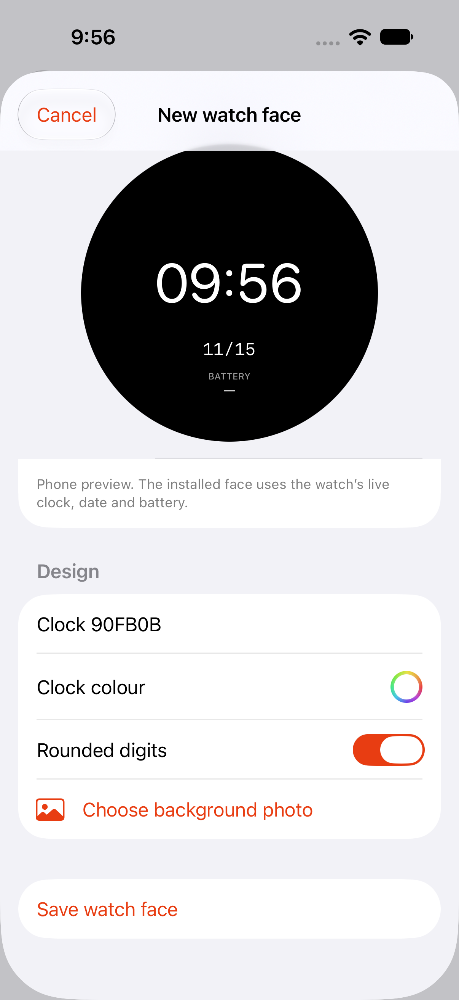
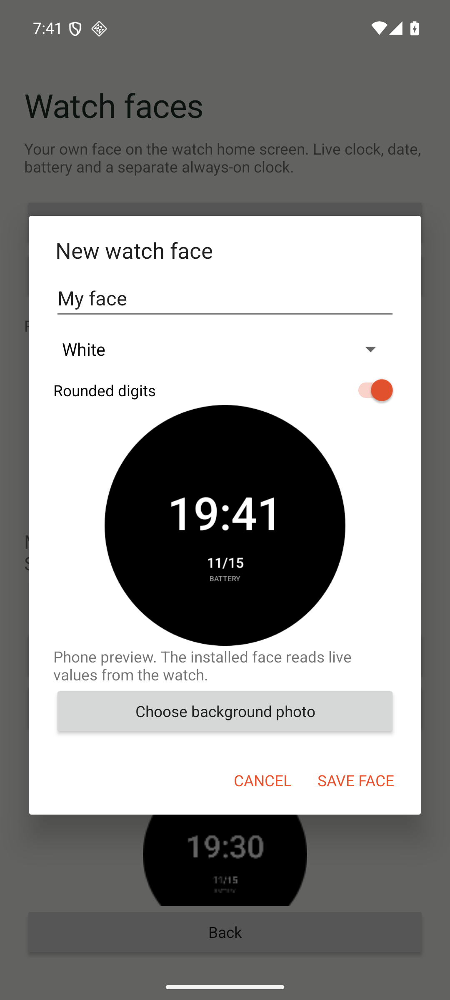
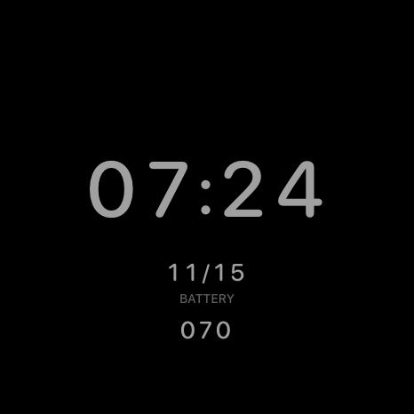

# Custom watch faces

Both companions can create and install a home-screen face for **Watch Pro 2
JX402 / D398 on firmware 1.0.0.73**. This feature uses the stock face manager;
it does not require the custom loader or another firmware update.

On iOS, open **Faces** or **Watch → Watch faces**. On Android, open **Watch → Watch faces**.
Choose **Create watch face**, enter a name, choose a clock colour and rounded
or regular digits, and optionally select a background photo. Save the face,
connect the watch, then choose **Install on watch** with custom apps closed.

The generated face has a live clock, month/day, battery percentage and a separate
dim always-on clock. Values come from the watch. The phone editor shows a preview
using the phone's time and date; it leaves battery blank until the watch supplies
it. Photo metadata is discarded when the image is rasterized into face pixels.
Saved faces and exported files stay available without a network connection.

  
  
  

## Import and share

**Import .wfdl or .bin** accepts supported Watch Pro 2 WFDL files. **Export file**
shares the saved file so another companion can import it. This is not Wear OS's
Watch Face Format, and files for other watch models are not supported.

The reader checks matching header/footer, both checksums, the node tree, image
references and bounded LZ4 decoding before sending anything. Current limits are
1.5 MB per file, 466 × 466 per image, 256 images, 2 MiB of decoded image data,
1,024 nodes and 16 levels of nesting. Image formats 4, 5, 13 and 14 and a bounded
set of image, number and preview widget tags are recognized. Analog hands,
procedural gauges, conditions and editable complications are currently rejected.
Some third-party files are intentionally
rejected; passing validation is not a guarantee of every stock feature's behavior.

## Installing and removing

Installation needs a **free face slot**. The companions do not delete an existing
face to make space. Remove an unwanted face using the watch's normal controls if
all slots are full. A “stored but not activated” response is shown as a failed
activation rather than an installed face.

Each confirmed upload is tracked locally for its paired watch. Use **Delete from
watch** to remove that tracked face after confirming. Faces installed with other
software are managed on the watch; the stock face-list response does not reliably
include sideloaded IDs. Keep this phone's saved face until you have removed its
watch copy if you want the companion to retain that association.

The uploader authenticates the stock session, checks the firmware, then uses the
FFE1/FFE2 face channel. It answers watch-requested ranges in paced, acknowledged
transfers and sends the mandatory finish reply. Success requires the watch's
activated result. It never invokes firmware OTA.

## Verification

The [0.3.0 face report](verification/0.3.0-faces.json) records an actual
iOS-generated file uploaded through the production Swift uploader to disposable
stock ARM firmware. The watch accepted it, loaded the home screen, rendered the
month/day correctly and advanced its clock on a natural minute tick. The fixture
initially had every slot full; the test frees one inactive reference face through
the stock delete protocol. It never uses a physical watch.

The emulator needs a texture-format hash index for newly uploaded RGB565+alpha
images. The test extends that metadata in a temporary fixture. It does not preload
the candidate face or modify its bytes. The test's loopback H4 transport cannot
write to physical Bluetooth hardware.

iOS UI automation checks creation, saving, persistence after restart and disabled
installation while disconnected. Swift and JVM protocol tests cover corrupt files,
invalid ranges, duplicate requests, transfer progress and refused activation.
Physical iOS and Android installation of this new face feature is still pending.

The codec and upload implementations are independently written from public
[format and protocol facts](https://github.com/freethinkel/fmc/blob/main/docs/cmf-protocol.md),
with source-ID readings checked against
[firmware protocol research](https://github.com/joshuapassos/CMF-Watch-Pro-2-BLE-Protocol).
The observed month source for the supported firmware is **0x16**; 0x15 displayed
the year in our ARM test. No upstream AGPL implementation is included.
